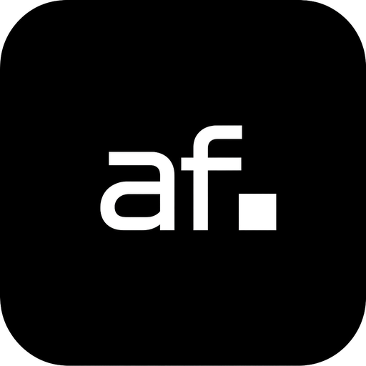
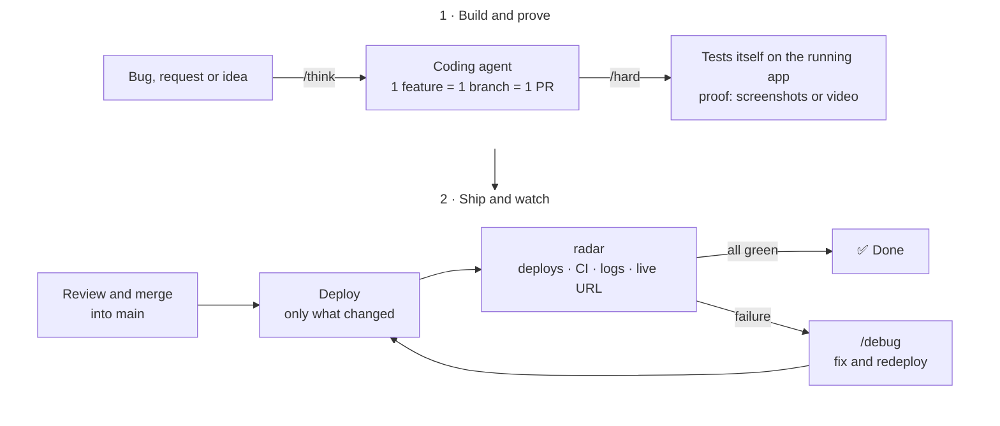

<p align="center">
  
</p>

# Workflow

**Skills that make AI coding agents build, test themselves on the running app, and prove it works.** Free and open source. Install it once and use it on any app.

## Why

AI agents write code fast. The hard part is trusting what they ship.

With Workflow, the agent does not stop at "the tests pass". It opens the running app in real conditions, checks the change works and that nothing else broke, and sends back screenshots or a video as proof. After the merge, it checks that production matches `main`.



Every skill follows the same rules: **keep it simple, question everything, delete what's useless, prove it works.**

## Install

**Cursor.** Open Customize, paste `https://github.com/romeohc/Workflow` in the plugin search, then install.

**Claude Code.**

```text
/plugin marketplace add romeohc/Workflow
/plugin install workflow@workflow
```

**Codex.**

```text
codex plugin marketplace add romeohc/Workflow
```

Then install `workflow` from `/plugins`.

## Quickstart

On your app, run `/setup`. It reads the repo and writes:

1. **`radar`**, a skill made for this app (`.cursor/skills/radar/SKILL.md`). For each deployed service, it holds the commands that read the live commit, the deploy state, the logs and the public address.
2. **Path-based deploys**, so a service ships only when `main` changes and its own files changed.
3. **A Cursor automation**, `Radar - <app name>`, that runs `radar` after every merge to `main`.

If `/setup` cannot finish, it names the one thing you have to do. Run it again whenever the app changes.

Then pick a skill for each task.

## Skills

| Skill | What it does |
| --- | --- |
| `/think` | Read-only. Answers a product, growth or code question as a founder and an engineer. Also checks whether a bug is real. |
| `/hard` | Implements the change, tests it on the running app, and proves it with screenshots and a short video. |
| `/fast` | Implements the change with no verification, then opens the ports so you can test it yourself. |
| `/debug` | Reproduces the bug, proves the cause with runtime evidence, and ships the smallest fix. |
| `/clean` | Read-only. Runs several agents in parallel on a path to find what to delete or simplify, then implements only the PR you pick. |
| `/setup` | Installs the app's workflow pieces: `radar`, path-based deploys and the post-merge automation. |
| `radar` | Written by `/setup` for each app. After a merge, checks deploys, CI, logs and the live URL. Replies `✅` when all is green, fixes a clear failure, and uses `/debug` when the cause is unknown. |

## In progress

- **`local`**: `/hard` and `/debug` expect a `local` skill that explains how to start and reach the app. `/setup` will write it.
- **`/clean` at night**: clean and simplify the codebase on a schedule, verify with `/hard`, and open a pull request.
- **Automatic PR review**: review engineering and security, check that the proof matches the request, then merge.

## Credits

Inspired by [pstack](https://github.com/poteto/plugins/tree/main/pstack) by Lauren Tan. Workflow keeps a few skills and adapts them to cloud agents.

## License

MIT. See [LICENSE](LICENSE).

---

Built by [Roméo HC](https://github.com/romeohc). Used every day to build and run [Novex](https://novex.trading).
